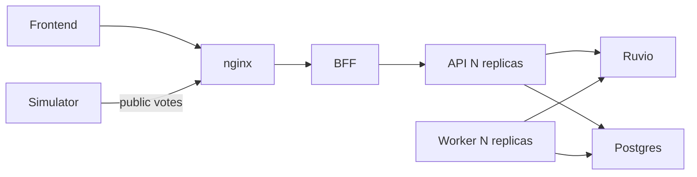
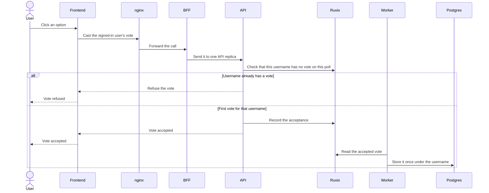
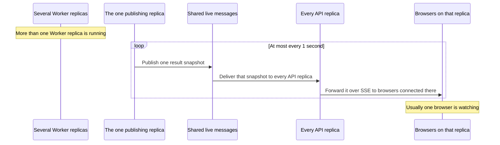
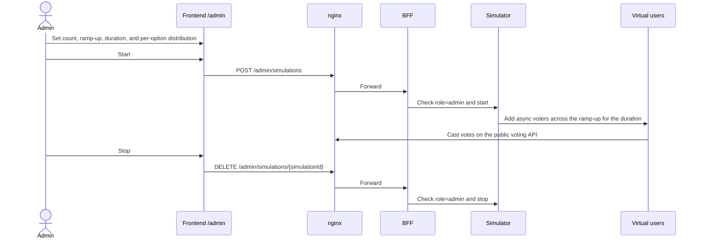

# Architecture

LivePoll's behavior is defined in [requirements.md](requirements.md). This document assigns that behavior to components. The stack is fixed: .NET 10 for the API, the Worker, the BFF, and the Simulator; PostgreSQL for durable storage; Ruvio for fast shared state; nginx in front of a YARP BFF; Docker Compose to run the system.

## Components

The Frontend and the Simulator both enter through nginx. The BFF spreads each call across API replicas. The API and the Worker share Ruvio and Postgres, so any replica can handle any request.

## Responsibilities

| Component | Does | Does not |
|---|---|---|
| nginx | Accepts public traffic from the Frontend and the Simulator and forwards it to the BFF. | Apply poll or vote rules, or store votes or sessions. |
| BFF | Presents one backend, spreads API calls across API replicas, and routes `/admin/simulations/*` to the Simulator after checking `role=admin`. | Own poll rules, the vote queue, durable votes, or a private voting path for the Simulator. |
| API | Signs a user in with a username and a stateless token, creates a poll, accepts one vote per username on an open poll, and serves results and business metrics. Records each acceptance in shared state. May cache a poll end time after the first read. | Keep a dev-token session in its process, store the durable vote itself, read Postgres on the vote path, or handle `/admin/simulations/*`. |
| Worker | Stores each accepted vote once in Postgres under that username, and keeps shared totals current so results stay live. | Accept the public voting call, sign users in, or lose an accepted vote when one replica stops. |
| Simulator | Runs the admin's virtual users for the chosen count, ramp-up, duration, and per-option distribution, and casts their votes through the public voting API. | Access Ruvio or Postgres directly. |
| Ruvio | Holds the counters, the vote queue, live messages between instances, locks, rate limiting, and the business metrics, for any replica to use. | Keep the durable copy of a vote. |
| Postgres | Stores polls, options, and each accepted vote once under the voter's username. | Carry live messages between instances, or hold a replica's private state. |
| Frontend | Offers sign-in, poll creation, voting, a results link with live totals and votes per second, admin edits, Simulator start and stop on /admin, and the metrics panel. | Choose a UI framework here, store votes, or call a specific API replica. |

## Runtime

`docker compose up` starts the whole system. The API and the Worker each run at least two replicas. Vote state lives in Ruvio and Postgres, outside either process, so a later call can land on any replica. The dev token is a signed stateless JWT. The API accepts a vote by recording it in Ruvio only. The Worker then stores it once in Postgres under the voter's username. If a Worker crashes, every vote the API has already accepted is still stored once. If one API replica and one Worker replica stop, a viewer still sees a new total within one second.

## Product behavior

A person signs in by choosing a username and receiving a stateless token. Usernames listed in `Admin__Users` receive `role=admin` on that token. They can create a poll with a title and from 2 to 6 options. A blank or whitespace-only title is refused. An option must be at least 3 characters and cannot be blank or whitespace. The poll is open for 10 minutes. A signed-in user casts one vote, stored under their username, and cannot change it or vote again. Only an admin can add, edit, or remove options or edit the title, and only before the poll has received a vote. Anyone with the link can view that poll's results, and the results stay available. The results page shows live vote totals and votes per second. The metrics panel shows votes per second, total votes, active polls, votes per option, and the worker backlog. On /admin, an admin sets the number of virtual users, ramp-up, duration, and vote distribution per option, and can start and stop them. Those virtual users vote through the same public voting API as a person.

## Vote flow

## Live results flow

## Simulation flow

## Data placement

| Data | Stored in | Why |
|---|---|---|
| Polls and options | Postgres | Any replica can serve the poll, and the results stay available |
| Each accepted vote, once, under the username | Postgres | The vote remains stored after a worker stops |
| Accepted votes not yet stored | Ruvio stream | Any worker replica can store each one, and the entry survives an `everysec` restart |
| Dev token | Signed JWT, not stored | Stateless. Any replica checks the signature. `role=admin` when the username is in `Admin__Users` |
| One-vote marker and poll end time | Ruvio | Both survive an `everysec` restart. The marker TTL is 24 hours |
| Live result snapshots | Ruvio pub/sub, not stored | Every API replica receives the same snapshot. A restart does not replay it |
| Business metrics | Ruvio | Any API replica can serve the metrics panel. A restart may drop up to 1 second, with no recount |

## Business metrics

| Metric | Where it lives |
|---|---|
| Votes per second | Publishing Worker, from vote-stream entry ids (Ruvio server time); results page and metrics panel |
| Total votes | Ruvio; metrics panel |
| Active polls | Ruvio sorted set scored by end time. The count is entries still after now. The publishing Worker removes older entries |
| Votes per option | Ruvio; metrics panel |
| Worker backlog | Ruvio; metrics panel, as accepted votes not yet stored |

## Resolved questions

1. React, Vite, and TypeScript. Recorded in ADR-0006.
2. Server-Sent Events. Recorded in ADR-0003.
3. Admin usernames come from `Admin__Users` (comma-separated). Those dev tokens include `role=admin`, and every `/admin/*` route requires it. Recorded in ADR-0004.
4. A vote accepted as the 10-minute window closes is still stored. Recorded in ADR-0002 R5.
5. With `everysec`, the vote stream, `ONCE` markers, and poll end-time keys survive a restart. Live snapshots are not stored. Metrics may lose 1 second and are not recounted. Dev tokens are stateless. Recorded in ADR-0001 and ADR-0004.
6. The BFF routes `/admin/simulations/*` to the Simulator and checks `role=admin` there. The API is not involved. Recorded in ADR-0004.
7. The vote path touches only Ruvio, and each API caches the poll end time after the first read. The 1,000-voter load test proves p95 under 100 ms; a miss means more API replicas. Recorded in ADR-0002.
8. Virtual voters are async tasks in the Simulator container, sharing one `HttpClient` with a connection limit, and a ramp-up. Recorded in ADR-0005.
9. The publisher sends at most one snapshot per poll every 1 second. Recorded in ADR-0003.
10. A lease shorter than one second hands publishing to another Worker, and the page opens the results stream again by itself. Recorded in ADR-0003.
11. Layers are `src/LivePoll.Domain` and `src/LivePoll.Application`, tested by `tests/LivePoll.Domain.Tests` and `tests/LivePoll.Application.Tests`. Coverlet fails the build under 80% line coverage for either assembly. Recorded in ADR-0005.
