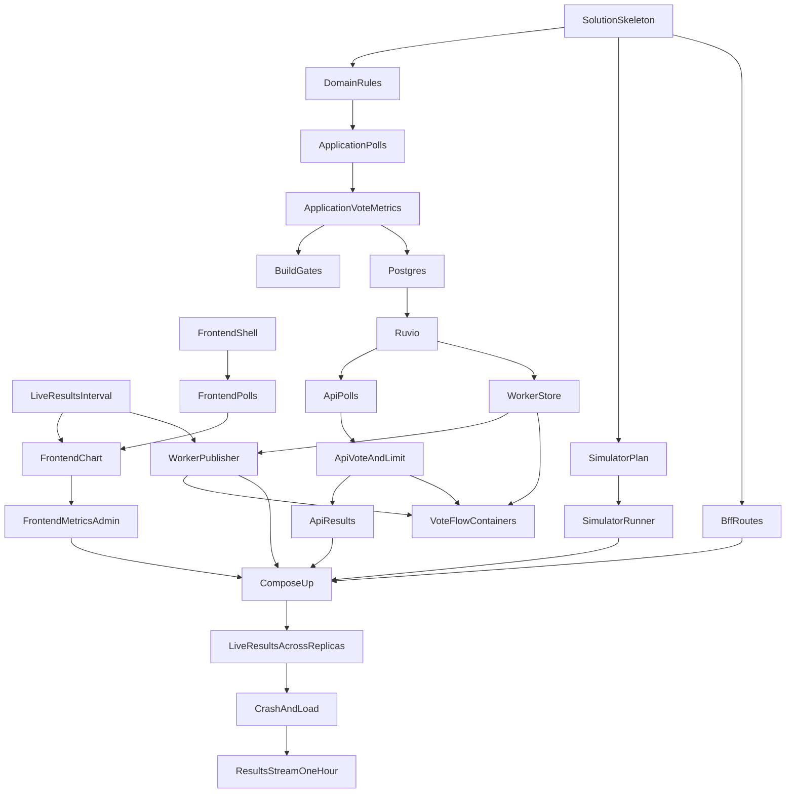

# Implementation plan

Same-wave tasks start together only because their dependencies are done and their folders do not overlap. If two tasks in the same wave both change one file, each has a Shared file note that names the file and says: "Change only one registration line here." `cloud-ok` means no Docker, no browser, and no localhost. Testcontainers, Compose, load, and the Vite dev server are `local`. Model: Strong for concurrency, consistency, or tricky Ruvio logic; Fast for scaffolding and repetitive work; Auto for everything else. Waves 11 to 13 stay one at a time because this computer runs one Compose suite.

A title over 120 characters is rejected in the domain (FR-16). [docs/api/openapi.yaml](../api/openapi.yaml) is not edited. Nothing in the requirements Out of Scope section is a task.

## Waves

| Wave | Tasks | Can run in parallel with |
| --- | --- | --- |
| 1 | Live results interval is one second; Solution skeleton and Docker Compose; Frontend shell and sign-in | Each other |
| 2 | Domain poll and vote rules; Frontend poll pages and admin edits; Simulator vote plan; BFF routes and admin gate | Each other |
| 3 | Application poll lifecycle; Frontend vote page and live chart; Simulator runs virtual voters | Each other |
| 4 | Application vote acceptance and business metrics; Frontend metrics panel and simulator controls | Each other |
| 5 | Coverage gate and TDD commit order; Postgres polls and votes | Each other |
| 6 | Ruvio queue, markers, and counters | None |
| 7 | API sign-in and poll routes; Worker stores each vote once | Each other |
| 8 | API vote route and rate limit; Worker publishes one snapshot per second | Each other |
| 9 | API live results and metrics routes; Vote flow against real Postgres and Ruvio | Each other |
| 10 | Compose starts the whole system | None |
| 11 | Live results across replicas | None |
| 12 | Crash recovery and one-machine load | None |
| 13 | Results stream stays open for one hour | None |

## Tasks

### [x] Live results interval is one second

- Issue: #2
- Depends on: none
- Touches: [docs/adr](../adr), [docs/architecture.md](../architecture.md)
- Where: cloud-ok
- Wave: 1
- Model: Auto
- Acceptance criteria:
  - ADR-0003 R5, the publish rule, the API forward rule, resolved question 9, and the verification row use 1 second, and the test is named `OneSnapshotPerPollEverySecond`.
  - The publish lease in ADR-0003 stays shorter than 1 second.
  - The live-results loop and resolved question 9 in [docs/architecture.md](../architecture.md) say 1 second.
  - The ADR-0006 sentence that cites the snapshot gap says 1 second.
  - [docs/api/openapi.yaml](../api/openapi.yaml) has no diff.
- Definition of done: tests green, coverage passes where it applies, zero build warnings, one commit.

### [x] Solution skeleton and Docker Compose

- Issue: #3
- Depends on: none
- Touches: `src/LivePoll.Domain`, `src/LivePoll.Application`, `src/LivePoll.Infrastructure`, `src/LivePoll.Api`, `src/LivePoll.Worker`, `src/LivePoll.Bff`, `src/LivePoll.Simulator`, `tests`, `nginx`
- Where: cloud-ok
- Wave: 1
- Model: Fast
- Acceptance criteria:
  - `dotnet build` finishes with zero warnings, and package versions live only in [Directory.Packages.props](../../Directory.Packages.props).
  - `node scripts/check-packages.mjs` passes.
  - The solution contains Domain, Application, Infrastructure, Api, Worker, Bff, and Simulator, with test projects for each, plus `tests/LivePoll.Build.Tests`.
  - The Compose file starts nginx, the BFF, the frontend, the Simulator, Postgres, Ruvio, and at least two API replicas and two Worker replicas, and this task does not run Compose.
  - Only nginx publishes a host port. Ruvio sets `RUVIO_REQUIREPASS` and `RUVIO_DURABILITY=everysec`. Postgres and Ruvio publish no host port.
- Definition of done: tests green, coverage passes where it applies, zero build warnings, one commit.

### [x] Frontend shell and sign-in

- Issue: #4
- Depends on: none
- Touches: `web`
- Where: cloud-ok
- Wave: 1
- Model: Fast
- Acceptance criteria:
  - `Frontend_TypesGeneratedFromOpenApi`: JSON types in `web/src/api` are generated from [docs/api/openapi.yaml](../api/openapi.yaml) and committed. The results EventSource is not generated.
  - `Frontend_TypecheckPasses` and `Frontend_ViteBuildWritesStaticFiles`: `vite build` writes static files and the project has no server-render entry.
  - `Frontend_DependenciesStayOnTheRecordedStack` and `Frontend_SurfaceIsReactFetchAndRecharts`: React, Vite, and Recharts only, function components, no private component library.
  - A Vitest signs in by sending only a username (FR-1) and stores the token for later `Authorization: Bearer` calls.
- Definition of done: tests green, coverage passes where it applies, zero build warnings, one commit.

### [x] Domain poll and vote rules

- Issue: #5
- Depends on: Solution skeleton and Docker Compose
- Touches: `src/LivePoll.Domain`, `tests/LivePoll.Domain.Tests`
- Where: cloud-ok
- Wave: 2
- Model: Auto
- Acceptance criteria:
  - A blank or whitespace-only title is rejected, and a title longer than 120 characters is rejected (FR-14, FR-16). OpenAPI is not edited.
  - An option that is blank, whitespace-only, or shorter than 3 characters is rejected (FR-14).
  - A poll with fewer than 2 or more than 6 options is rejected (FR-3).
  - The open window is 600 seconds (FR-15).
  - After a vote, the title and the options cannot be added, edited, or removed, and a voter cannot add an option (FR-4, FR-7).
  - A second vote by the same username is rejected (FR-6).
  - Coverlet line coverage for `LivePoll.Domain` is at least 80% (NFR-9).
- Definition of done: failing tests committed, then one implementation commit; tests green, Domain line coverage at least 80% (NFR-9), zero build warnings.

### [x] Frontend poll pages and admin edits

- Issue: #6
- Depends on: Frontend shell and sign-in
- Touches: `web`
- Where: cloud-ok
- Wave: 2
- Model: Fast
- Acceptance criteria:
  - A Vitest creates a poll with a title and 2 to 6 options through the generated client (FR-2, FR-3).
  - With `role=admin` in the token, the page can edit the title and add, edit, and remove an option. Without that role, those controls are absent (FR-4).
  - The tests are Vitest. There is no browser end-to-end test.
- Definition of done: tests green, coverage passes where it applies, zero build warnings, one commit.

### [x] Simulator vote plan

- Issue: #7
- Depends on: Solution skeleton and Docker Compose
- Touches: `src/LivePoll.Simulator`, `tests/LivePoll.Simulator.Tests`
- Where: cloud-ok
- Wave: 2
- Model: Auto
- Acceptance criteria:
  - `SimulatorPlanTests.CountRampDurationAndSplitShapeTheVotes`: changing voter count, ramp-up, duration, or the per-option split changes who joins, when they join, how long they vote, and how votes divide (FR-11).
  - `SimulatorPlanTests.SameSettingsAndSeedProduceTheSameVotes`: the same settings and seed list the same votes. A different seed lists a different split.
  - Join time, username, and chosen option are pure functions of the index, count, ramp-up, distribution, and seed.
  - The Simulator project does not reference a Ruvio client or a Postgres client.
- Definition of done: tests green, coverage passes where it applies, zero build warnings, one commit.

### [x] BFF routes and admin gate

- Issue: #8
- Depends on: Solution skeleton and Docker Compose
- Touches: `src/LivePoll.Bff`, `tests/LivePoll.Bff.Tests`
- Where: cloud-ok
- Wave: 2
- Model: Auto
- Acceptance criteria:
  - Each API replica is its own destination, session affinity is off, and the Worker is not a destination.
  - `/admin/simulations/*` is sent to the Simulator. The API is not a destination for that path.
  - `AdminRoutes_RequireRoleAdmin`: that path is forbidden unless the token has `role=admin`.
  - The results route is unbuffered and its timeout is at least 1 hour.
- Definition of done: tests green, coverage passes where it applies, zero build warnings, one commit.

### [x] Application poll lifecycle

- Issue: #9
- Depends on: Domain poll and vote rules
- Touches: `src/LivePoll.Application`, `tests/LivePoll.Application.Tests`
- Where: cloud-ok
- Wave: 3
- Model: Auto
- Acceptance criteria:
  - A signed-in user can create a poll, and `endsAt` is `createdAt` plus 10 minutes (FR-2, FR-15).
  - Invalid title and option commands from the domain are rejected (FR-14, FR-16).
  - An admin can edit the title and add, edit, or remove options before any vote. The option count stays from 2 to 6. A non-admin is rejected (FR-4).
  - After any vote, those edits are rejected (FR-7).
  - Coverlet line coverage for `LivePoll.Application` is at least 80% (NFR-9).
- Definition of done: failing tests committed, then one implementation commit; tests green, Application line coverage at least 80% (NFR-9), zero build warnings.

### [x] Frontend vote page and live chart

- Issue: #10
- Depends on: Frontend poll pages and admin edits, Live results interval is one second
- Touches: `web`
- Where: cloud-ok
- Wave: 3
- Model: Auto
- Acceptance criteria:
  - `PollPage_ChartReplacesTotalsFromSseEvent`: one SSE snapshot sets each option's bar and the votes-per-second figure. A second snapshot replaces both. The chart does not keep the first snapshot (FR-9).
  - Recharts animation is off.
  - `PollPage_ReopensResultsStreamWhenItEnds`: when the response ends, the page opens a new EventSource on the same public results URL.
  - The results EventSource sends no Bearer token (FR-8).
  - Votes per second is the number on the snapshot. The page does not keep a votes-per-second history.
- Definition of done: tests green, coverage passes where it applies, zero build warnings, one commit.

### [x] Simulator runs virtual voters

- Issue: #11
- Depends on: Simulator vote plan
- Touches: `src/LivePoll.Simulator`, `tests/LivePoll.Simulator.Tests`
- Where: cloud-ok
- Wave: 3
- Model: Strong
- Acceptance criteria:
  - Voters are async tasks on one shared `HttpClient` backed by `SocketsHttpHandler` with a connection limit, and ramp-up overlaps them (FR-11).
  - Against a fake handler, every voter signs in and votes only on the public auth and vote paths (FR-13).
  - A 429 from the vote call is not retried.
  - Start, stop, and elapsed duration report `running`, `stopped`, and `completed` (FR-12).
- Definition of done: tests green, coverage passes where it applies, zero build warnings, one commit.

### [x] Application vote acceptance and business metrics

- Issue: #12
- Depends on: Application poll lifecycle
- Touches: `src/LivePoll.Application`, `tests/LivePoll.Application.Tests`
- Where: cloud-ok
- Wave: 4
- Model: Strong
- Acceptance criteria:
  - The first vote for a username is accepted. A repeat is rejected, including two overlapping calls through a fake one-vote marker (FR-5, FR-6).
  - A vote after `endsAt` is rejected and records no acceptance. A vote accepted as the window closes is still accepted for storage (FR-15).
  - `ActivePolls_CountByEndTime`: the active count is entries whose end time is after now.
  - `VotesPerSecond_FromStreamEntryIds`: votes per second are the count of stream entry ids in the previous Ruvio server second, not an API clock (FR-9, FR-10).
  - The worker backlog is the accepted-not-stored counter. A missing total, option count, or backlog reads as zero (FR-10).
  - Coverlet line coverage for `LivePoll.Application` is at least 80% (NFR-9).
- Definition of done: failing tests committed, then one implementation commit; tests green, Application line coverage at least 80% (NFR-9), zero build warnings.

### [x] Frontend metrics panel and simulator controls

- Issue: #13
- Depends on: Frontend vote page and live chart
- Touches: `web`
- Where: local
- Wave: 4
- Model: Fast
- Acceptance criteria:
  - `MetricsPanelTests.ShowsFiveMetricsAndRefreshesEverySecond`: the panel shows votes per second, total votes, active polls, votes per option, and the worker backlog, and it requests them at least once a second (FR-10). The test is Vitest, not a browser end-to-end test.
  - `/admin` can set voter count, ramp-up, duration, per-option distribution, and seed, and it can start and stop (FR-11, FR-12). Those calls use the generated client and a Bearer token.
  - `ViteDev_AcceptsConnectionsWithinFiveSeconds`: Vite accepts a connection within 5 seconds and does not wait for the API process.
- Definition of done: tests green, coverage passes where it applies, zero build warnings, one commit.

### [x] Coverage gate and TDD commit order

- Issue: #14
- Depends on: Application vote acceptance and business metrics
- Touches: `tests/LivePoll.Build.Tests`, `scripts`
- Where: cloud-ok
- Wave: 5
- Model: Fast
- Acceptance criteria:
  - `CoverageGateTests.DomainAndApplicationLineCoverageAtLeast80`: Coverlet measures Domain and Application separately, and the build fails when either line coverage is under 80% (NFR-9).
  - `TddCommitOrderTests.TestCommitPrecedesImplementation`: a Domain or Application production change fails the build when the failing test is not an earlier commit.
- Definition of done: tests green, coverage passes where it applies, zero build warnings, one commit.

### [x] Postgres polls and votes

- Issue: #15
- Depends on: Application vote acceptance and business metrics
- Touches: `src/LivePoll.Infrastructure`, `tests/LivePoll.Infrastructure.Tests`
- Where: local
- Wave: 5
- Model: Auto
- Acceptance criteria:
  - The test starts a real Postgres container and does not mock it.
  - `Postgres_IsPermanentRecord`: polls, options, and each vote under that username are rows and are still there after the writing process stops.
  - A second insert for the same poll and username does not add a second row (FR-5, FR-6).
- Definition of done: tests green, coverage passes where it applies, zero build warnings, one commit.

### [x] Ruvio queue, markers, and counters

- Issue: #16
- Depends on: Postgres polls and votes
- Touches: `src/LivePoll.Infrastructure`, `tests/LivePoll.Infrastructure.Tests`
- Where: local
- Wave: 6
- Model: Strong
- Acceptance criteria:
  - The fixture starts `salihcantekin/ruvio` with a password and `RUVIO_DURABILITY=everysec`, and it does not mock Ruvio.
  - `OnceMarker_TtlIs24Hours`: the one-vote marker lasts 24 hours, and a second vote inside that time is rejected.
  - Acceptance is `XADD` with no `DELAY`. Backlog is the accepted-not-stored counter (ADR-0005), not `XPENDING` or `XLEN`. The end-time key has no expiry.
  - Acceptance increments total votes, that option, and the backlog. The store path decrements the backlog once.
  - Active polls are a sorted set scored by end time.
  - `RuvioRestart_KeepsStreamOnceAndEndTime`: after the `everysec` sync, a restart still has the unstored stream entry, the `ONCE` marker, and the end-time key. A snapshot from before the restart is gone.
  - `MetricsDrift_AcceptedNoRecount`: after that loss window, metrics are not rebuilt from Postgres.
  - The queue path uses no broker other than Ruvio.
- Definition of done: tests green, coverage passes where it applies, zero build warnings, one commit.

### [x] API sign-in and poll routes

- Issue: #17
- Depends on: Ruvio queue, markers, and counters
- Touches: `src/LivePoll.Api`, `tests/LivePoll.Api.Tests`
- Where: cloud-ok
- Wave: 7
- Model: Auto
- Acceptance criteria:
  - `TokenFromUserNameOnly`: a username and no password returns a signed stateless JWT (FR-1). A blank username returns 400 problem+json.
  - `AdminUsers_ReceiveRoleAdmin`: a name in `Admin__Users` gets `role=admin`. Any other name does not.
  - Create and get poll match the OpenAPI statuses, including 201 with `durationSeconds` 600 and `Location`, 401, and 400 problem+json (FR-2, FR-3, FR-15).
  - Admin title and option routes return 403 without `role=admin`, and 409 `/problems/poll-has-votes` after a vote (FR-4, FR-7).
  - The same token is accepted with no server session stored in the process (NFR-5).
- Definition of done: tests green, coverage passes where it applies, zero build warnings, one commit.

### [x] Worker stores each vote once

- Issue: #18
- Depends on: Ruvio queue, markers, and counters
- Touches: `src/LivePoll.Worker`, `tests/LivePoll.Worker.Tests`
- Where: cloud-ok
- Wave: 7
- Model: Strong
- Acceptance criteria:
  - The worker acks a vote only after the Postgres commit, and a redelivery of an existing poll-and-username row does not insert again (FR-5).
  - `FailingVote_KeptAside_OtherVotesProceed`: a delivery count greater than 3 is appended to the side stream and acked, and a later good vote is still stored.
  - The backlog is decremented once for that store (FR-10).
  - The blocking read uses its own Ruvio client.
  - The worker has no sign-in or public vote endpoint.
- Definition of done: tests green, coverage passes where it applies, zero build warnings, one commit.

### [x] API vote route and rate limit

- Issue: #19
- Depends on: API sign-in and poll routes
- Touches: `src/LivePoll.Api`, `tests/LivePoll.Api.Tests`
- Where: local
- Wave: 8
- Model: Strong
- Acceptance criteria:
  - Cast vote returns 202 with the username from the token (FR-5). Repeat and ended polls return 409 `/problems/already-voted` and `/problems/poll-ended`.
  - `VotePath_TouchesOnlyRuvio`: the accept path reads the end time, calls `ONCE` and `XADD`, and updates counters. It does not open Postgres.
  - `EndTimeCachedAfterFirstRead`: the second vote for a poll on the same API process does not read the end-time key again.
  - `RateLimitPackage_LoadsOnNet10`: the .NET 10 host starts with `Ruvio.AspNetCore.RateLimiting` registered.
  - `LimitFollowsUserName`: from one client address, the username that exceeds the configured fixed window receives 429 with `Retry-After`, and a second username still succeeds. The test records the finite permit count and window.
  - `VoteLimiter_FailClosed_Returns503`: when Ruvio is unavailable, the vote route returns 503 and does not accept the vote.
  - Sign-in and the results stream have no limit policy.
- Definition of done: tests green, coverage passes where it applies, zero build warnings, one commit.

### [x] Worker publishes one snapshot per second

- Issue: #20
- Depends on: Worker stores each vote once, Live results interval is one second
- Touches: `src/LivePoll.Worker`, `tests/LivePoll.Worker.Tests`
- Where: cloud-ok
- Wave: 8
- Model: Strong
- Acceptance criteria:
  - `OnlyLeaseHolderPublishes`: with two workers, only the fenced-lease holder publishes.
  - `PausedReplicaCannotPublishOldSnapshot`: a worker paused longer than the lease does not publish the snapshot it built before the pause, and a smaller fencing token does not replace a newer snapshot.
  - `OneSnapshotPerPollEverySecond`: a burst produces a gap of at least 1 second between snapshots for that poll.
  - The lease passed to `TryAcquireAsync` is shorter than 1 second.
  - The snapshot carries current option totals, including votes not yet stored, and votes per second from stream entry ids.
  - The publishing worker removes active-poll entries whose end time is at or before now. There is no scheduled close job.
- Definition of done: tests green, coverage passes where it applies, zero build warnings, one commit.

### [x] API live results and metrics routes

- Issue: #21
- Depends on: API vote route and rate limit
- Touches: `src/LivePoll.Api`, `tests/LivePoll.Api.Tests`
- Where: cloud-ok
- Wave: 9
- Model: Strong
- Acceptance criteria:
  - `LiveResultsUseDotNet10Sse`: the results response uses the .NET 10 Server-Sent Events API. The host does not serve WebSocket or SignalR (FR-9).
  - Get results and the stream return 200 with no token, stay available after the poll ends, and the stream uses event name `results`, a `ResultsSnapshot` payload, and `Cache-Control: no-cache` (FR-8).
  - The API drops a snapshot whose fencing token is smaller than the newest token it has accepted for that poll, and it forwards at most one snapshot per poll per viewer per second.
  - Get metrics returns votes per second, total votes, active polls, votes per option, and `votesWaitingForPostgres` (FR-10).
- Definition of done: tests green, coverage passes where it applies, zero build warnings, one commit.

### Vote flow against real Postgres and Ruvio

- Issue: #22
- Depends on: API vote route and rate limit, Worker stores each vote once, Worker publishes one snapshot per second
- Touches: `tests/LivePoll.Integration.Voting`
- Where: local
- Wave: 9
- Model: Strong
- Acceptance criteria:
  - `VoteFlowContainerTests.PersistsThroughRealPostgresAndRuvio`: a real Postgres container and a real Ruvio container accept a vote, and the test reads the stored row and the shared acceptance with no mock of either.
  - `OneVotePerPoll_DuplicateAndSameMoment`: the same username twice, including overlapping requests, produces one acceptance and one stored row (FR-6).
  - `AcceptedVote_ReachesPostgres_Within5Seconds`: a storable vote is one Postgres row within 5 seconds of acceptance.
  - `EndedPoll_VoteRejected`: a vote after 10 minutes is neither queued nor stored (FR-15).
  - A vote accepted as the window closes is still stored once.
  - `RuvioRestart_AfterSync_VoteStillStored`: with the data directory kept, a vote left past the `everysec` sync is stored once after Ruvio restarts.
  - `BusinessMetricsStorageTests.FiveCountersAreReadFromRuvio`: total votes, votes per option, and the backlog are served from Ruvio, and votes per second match the publishing worker's stream-id count (FR-10).
- Definition of done: tests green, coverage passes where it applies, zero build warnings, one commit.

### [x] Compose starts the whole system

- Issue: #23
- Depends on: API live results and metrics routes, Worker publishes one snapshot per second, Frontend metrics panel and simulator controls, Simulator runs virtual voters, BFF routes and admin gate
- Touches: `nginx`, `src/LivePoll.Bff`, `src/LivePoll.Simulator`, `web`, `docker-compose.yml`, `tests/LivePoll.Integration.Compose`
- Where: local
- Wave: 10
- Model: Fast
- Acceptance criteria:
  - `ComposeUp_StartsWholeSystem`: from a clean machine, `docker compose up` alone can create a poll, cast a vote, and view results (NFR-8).
  - Compose starts nginx, the BFF, the frontend, and a Simulator host. The Simulator accepts `/admin/simulations` and its voters call the public API.
  - The API services are named `api1` and `api2`, matching the BFF destinations, so both names resolve on the Docker network.
  - The BFF receives the same `Jwt__SigningKey` as the API.
  - `ApiAndWorker_AtLeastTwoReplicas`: after startup, at least two API replicas and two Worker replicas are running (NFR-6).
  - `OnlyNginxIsPublished`: from outside the Docker network, only nginx accepts a connection, that port serves the frontend, and an API call on it reaches the BFF.
  - `DataPortsRefuseOutside`: a client outside the Docker network cannot connect to Ruvio or Postgres. A container on that network can.
  - `CallsReachEveryApiReplica`: API calls through nginx are handled by every running API replica.
  - `Browser_TalksOnlyToNginx`: sign-in, voting, results, and metrics traffic goes to nginx and does not open Ruvio or Postgres.
- Definition of done: tests green, coverage passes where it applies, zero build warnings, one commit.

### [x] Live results across replicas

- Issue: #24
- Depends on: Compose starts the whole system
- Touches: `tests/LivePoll.Integration.Results`
- Where: local
- Wave: 11
- Model: Strong
- Acceptance criteria:
  - `AcceptedVoteVisibleWithinOneSecond`: with a results stream open, one accepted vote is visible within 1 second (NFR-3).
  - `VoteJustAfterSnapshotVisibleWithinOneSecond`: a vote accepted just after a snapshot is on the viewer's stream within 1 second (NFR-3).
  - `ResultsEventsFlushImmediately`: a results event written by the API reaches the client while the stream is still open.
  - `VoteOnOneReplicaVisibleOnAnother`: a vote accepted on one API replica updates a viewer whose stream is on another API replica.
  - When one API replica stops, an open SSE client reconnects and keeps receiving results (NFR-7).
  - When one Worker replica stops, a viewer still receives a new total within 1 second (NFR-7).
  - `BrowserNeverConnectsToRuvio`: while results are watched, every client connection is to the public site.
- Definition of done: tests green, coverage passes where it applies, zero build warnings, one commit.

### [x] Crash recovery and one-machine load

- Issue: #25
- Depends on: Live results across replicas
- Touches: `tests/LivePoll.Integration.Load`
- Where: local
- Wave: 12
- Model: Strong
- Acceptance criteria:
  - `WorkerCrash_BeforeAck_VoteStoredOnce`: killing the worker after acceptance and before ack still leaves that vote stored once under the username (NFR-4).
  - `OtherReplicaCompletesTheVote`: one API replica accepts a vote, a different Worker replica stores it once, and a different API replica accepts a later call with the same token (NFR-5).
  - `SimulatorHttpTests.VotesOnlyThroughNginxPublicApi`: virtual voters sign in and vote only through nginx, and the votes are stored while the Simulator cannot open Ruvio or Postgres (FR-13).
  - `SimulatorLoadTests.OneThousandConcurrentVotersOnOneMachine`: one machine runs 1,000 async voters at the same time through the public voting API (NFR-2).
  - `VoteEndpoint_P95_Under100ms_With1000Voters`: at that concurrency, vote API p95 is under 100 ms (NFR-1). The accept path stays Ruvio-only.
- Definition of done: tests green, coverage passes where it applies, zero build warnings, one commit.

### [x] Results stream stays open for one hour

- Issue: #26
- Depends on: Crash recovery and one-machine load
- Touches: `tests/LivePoll.Integration.ResultsHour`
- Where: local
- Wave: 13
- Model: Auto
- Acceptance criteria:
  - No test run may wait an hour.
  - A fast test reads nginx.conf and the BFF settings: read and activity timeouts are at least one hour and buffering is off.
  - `ResultsStreamHoldsOneHour` keeps a stream open through nginx and the BFF for `RESULTS_HOLD_MINUTES` (default 3) and checks that events keep arriving.
  - `RESULTS_HOLD_MINUTES=60` is a manual full run, not part of the normal test run.
- Definition of done: tests green, coverage passes where it applies, zero build warnings, one commit.
